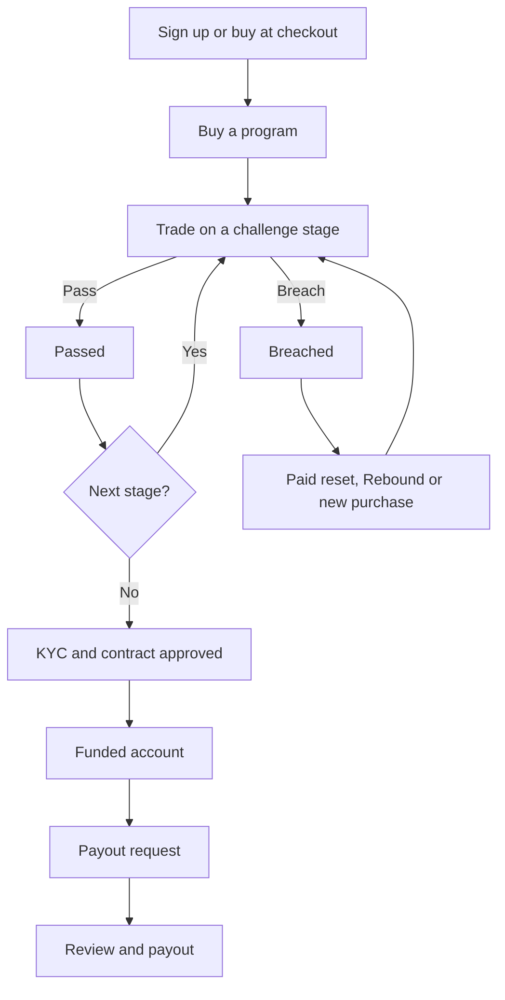

# Master User Flow

The whole journey of a trader on the platform, with a pointer to the page that explains each step. Almost every step has per-firm or per-program settings.

## 1. Account and purchase

- A trader can register first, or buy at checkout, which creates the account and emails a temporary password. Google sign-in exists too.
- The emailed verification code at sign-up and login is a **firm-wide setting**. When it is off, traders register and log in without a code. Staff logins always require it.
- Checkout offers the payment gateways your firm has switched on, add-ons, bundles and up to two stackable coupons. Free trial and free challenge programs start from their own pages.
- **Pay After Pass** programs split the price: an initial price now and the remaining price once, before the funded account. See [Pass & Progression](/admin/pass-progression).

## 2. Trading and monitoring

Each stage is its own account. The rule engine watches it live: see [Trading & Monitoring](/admin/trading-monitoring) and [Breach Detection](/admin/breach-detection).

## 3. Pass or breach

- A pass disables the old account and creates the next stage, or leads to funded.
- A breach disables trading and records the reason. The trader can then be offered a paid reset ([Paid Reset](/admin/paid-reset)) or a Rebound, or buy again.

## 4. Funded

Before the funded account exists the trader needs approved **KYC** and an approved **contract**, and you can hold the account for manual approval.

## 5. Payouts

A payout request needs the same approved KYC and contract, a funded account and a completed payout cycle. Staff approve, reject or cancel it: see [Withdrawal Flow](/admin/withdrawal-flow).

## Account states

Accounts are **live**, **passed** or **breached**. Stages are phase 1 to 3, funded, passed and breached, plus a Pay After Pass account awaiting payment.
