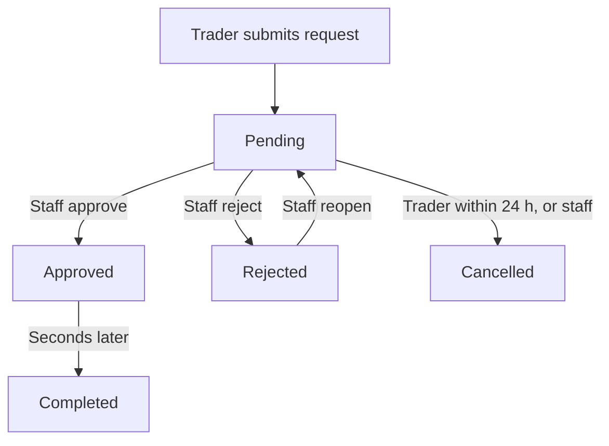

# Withdrawal Flow

How payout requests work for your firm's staff: what a trader needs before requesting, what you do with a request, and what each decision does to the account. Staff roles that can work withdrawals: admin, back office and sales.

## Status flow

Statuses: pending, approved, completed, rejected, cancelled. There is no appeal or second-review step: a rejected request can only be reopened to pending by staff.

## What a trader needs before requesting

The request is refused unless all of these hold:

- The account is a funded account. Free trial accounts are always refused.
- The trader's KYC and contract are approved.
- The payout cycle conditions of the program are met: minimum trading days (counted from the first closed trade of the cycle), an optional minimum profit per day, and the waiting period for that payout number. Add-ons can change these, including an on-demand option.
- There is profit above the account size to pay out, and the amount is at least **$10**.
- No other request is open on the account, and all positions are closed.
- The chosen payout method is switched on for your firm.

### Limits you can configure

- **Payout rules per payout number**: minimum days, minimum profit, profit split. The split is taken from the payout rule, then an add-on, then a per-account override. If none is set the default is 80%.
- **Payout cap**: a percentage cap per program and a lifetime cap per account.
- **Free challenge**: one capped payout.
- **Payout methods**: crypto, bank transfer, Revolut Tag and Rise Pay, each switched on or off for your firm in the withdrawal settings. Rise Pay is switched on in payment configuration.

## When a request arrives

On submission trading on the account is switched off until a decision is made. Staff see the request in the Withdrawals area of the admin menu. A risk review summary can be attached to the request, and traders can see the published summary.

## Decisions

**Approve**

- The payout amount plus your firm's share is deducted from the MT5 balance.
- The request is marked completed seconds later. There is no separate "mark as completed" step and no proof upload.
- The approved and confirmed emails go out together, with a payout certificate email if you have a certificate template.
- After a full payout the account returns to its starting balance and the payout cycle restarts. A partial payout keeps the remainder.

**Reject**

- By default the requested amount plus your firm's share is **deducted from the account as a penalty**. Use this when a rule was broken.
- Tick **Reset Account (No Penalty)** to reject without a deduction, for example after an administrative error.
- Trading on the account is switched back on.
- A reason is required and is sent to the trader.

**Cancel**

- Staff can cancel a request, for example when payout details are wrong. No penalty applies and the trader can submit again at once.
- A trader can cancel their own pending profit payout within 24 hours. This does not apply to a challenge reward claim. The reason is recorded as "Cancelled by the trader from the dashboard", so you can tell it from a staff cancellation.

## Emails

Default subjects: "Payout Request Received", "Payout Approved", "Payout Confirmed", "Payout Request Rejected" and "Your Withdrawal Request Has Been Cancelled". You can edit the wording in your email templates.

## Related

- [Paid Reset of a Breached Account](/admin/paid-reset)
- Trader view: [Withdrawal Process](/client/withdrawal-process)
